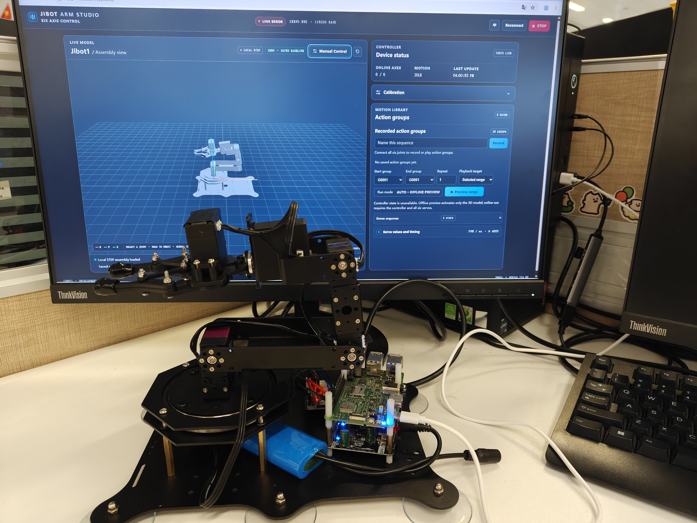

# Jibot1 Six-Axis Robotic Arm Control Demo
[English](README.md) | [简体中文](README_zh.md)

[](https://github.com/Quectel-Pi/)

This project uses a Quectel Pi M2 and a ZL-IS2 controller to operate the Jibot1 six-axis bus-servo arm through a browser-based console. It supports individual joint control, action recording and playback, fixed-position pick-and-place demonstrations, and a 3D view of the arm's pose.



**Demo video:** [Watch the robotic-arm control demo](assets/demo-robotic-arm-control.mp4)

---

## Features

- Control J1–J6 servos individually, adjust joint angles, and view their online status in the browser.
- Record, save, and play action groups; preset front, left, right, and place actions demonstrate pick-and-place at fixed positions.
- Load the Jibot1 STEP model and update its 3D pose from joint state, with orbit, zoom, and joint selection.
- Preview model motion offline and stop active motion with STOP; offline preview does not drive the physical arm.

---

## Hardware Configuration

| Hardware | Requirement and purpose |
|---|---|
| Quectel Pi M2 development board | Required; runs the control service |
| Jibot1 six-axis bus-servo arm | Required; driven by the ZL-IS2 controller |
| ZL-IS2 / ZLink controller board | Required; communicates with the M2 over UART |
| UART wires | Required; connect the M2 40-pin header to the ZLink controller |
| M2 power supply and arm battery | Required; use according to device specifications. The ZLink controller board is powered by the arm battery |
| Browser client | Required; must be able to access the M2 web console over the network |

**Hardware connections**

The following connections use the physical pin numbers on the M2 40-pin header:

| M2 40-pin pin | ZLink controller UART |
|---:|---|
| 9 | GND |
| 8 | RX |
| 10 | TX |

Do not connect the arm battery supply to the M2 40-pin header. See [Wiring and Power-up](docs/01-接线与上电方案.md) for details.

---

## Quick Start

Run these steps on Quectel Pi M2 Linux. Python 3.10 or later is required; run `python3 --version` to check.

```bash
# 1. Install Git and Python virtual-environment support
sudo apt update
sudo apt install -y git python3 python3-venv nano
python3 --version  # Confirm the version is 3.10 or later

# 2. Clone the project from GitHub directly on the development board
mkdir -p ~/projects
cd ~/projects
git clone https://github.com/Quectel-Pi/demo-robotic-arm-control.git
cd demo-robotic-arm-control

# 3. Create the virtual environment and install project dependencies
bash scripts/deploy_environment.sh

```

**Configure the browser access IP**

From the project directory, run `nano config.yaml` and set `web.allowed_client_ip` to the browser device's actual LAN IP. Replace the sample address with the browser device's IP; do not enter the M2 address or a CIDR suffix:

```yaml
web:
  allowed_client_ip: "192.168.1.23" # Replace with the browser device's IP; do not add a CIDR suffix.
```

In nano, press Ctrl+O, Enter to save, then Ctrl+X to exit.

**Start the web console**

```bash
bash scripts/start_web.sh
```

The service listens on port 8080. Localhost is always allowed; only the configured browser device can access the page and control API from the network. On the M2's local browser, open `http://127.0.0.1:8080/`. To access it from another device, run `hostname -I` in an M2 terminal to find the board's network address, then open `http://<M2_IP>:8080/` from the configured browser device. If the browser device's IP changes, update `config.yaml` and restart the service. When started manually, the service runs in the foreground; press Ctrl+C to stop it.

**Optional: start the service at boot**

To start the web console automatically when the board boots, run the auto-start manager and choose the enable option. It installs a systemd service and starts it immediately if port 8080 is free. You can also select an operation directly:

```bash
bash scripts/manage_autostart.sh enable  # Enable auto-start
bash scripts/manage_autostart.sh status  # Show service status
bash scripts/manage_autostart.sh disable # Disable auto-start
```

Enabling and disabling require sudo. If port 8080 already has a listener, the script leaves the current process untouched and enables startup for the next boot. Disabling auto-start does not stop a service that is already running. Without auto-start, use `bash scripts/start_web.sh` to launch the console manually.

**Results**

The web console loads the Jibot1 STEP assembly and shows controller status and the number of online joints. Online control is available when all six servos are online. If fewer than six are online, offline preview animates the model without moving the physical arm.

The 3D view redraws only when the model, pose, or camera changes. Model animation is capped at 30 FPS. Dragging the 3D view can render at up to 60 FPS with a temporarily reduced render scale, which is restored when dragging ends to improve responsiveness while limiting graphics load on the development board.

**Usage Instructions**

- Click a joint in the 3D model or open the manual control panel to set one joint's target angle. Releasing the slider submits the motion command.
- Record and save joint poses in the action-group panel, then play them back. Preset front, left, right, and place groups demonstrate pick-and-place at fixed positions; place the object at the corresponding preset location.
- Use STOP to stop current motion. Drag the model to orbit the view and scroll to zoom.
- Use the language button to switch between English and Chinese.

**Developer Documentation**

- [Wiring and Power-up](docs/01-接线与上电方案.md): M2-to-ZLink UART wiring and controller configuration.
- [SKILL.md](SKILL.md) (Chinese): quickstart workflow and reference guidance for AI assistants.
- The project code uses [Apache License 2.0](LICENSE.txt). Third-party licenses remain with their components: [Three.js MIT](web/vendor/three-LICENSE.txt) and [OCCT STEP parser LGPL-2.1](web/vendor/occt/LICENSE.md). Python dependencies are listed in [requirements.txt](requirements.txt).

---

## Project Structure

```text
demo-robotic-arm-control/
├── SKILL.md                       # quickstart workflow and AI assistant guide
├── assets/
│   ├── demo-robotic-arm-control.png # arm and browser-console photo
│   └── demo-robotic-arm-control.mp4 # robotic-arm control demo video
├── docs/
│   └── 01-接线与上电方案.md        # wiring and controller notes
├── LICENSE.txt                     # project Apache-2.0 license
├── config.yaml                      # serial, safety, and browser IP configuration
├── pyproject.toml                  # Python project metadata
├── requirements.txt                # Python runtime dependencies
├── scripts/
│   ├── deploy_environment.sh       # create environment and install dependencies on M2
│   ├── manage_autostart.sh         # optionally install and toggle systemd auto-start
│   └── start_web.sh                # start the web console
├── src/demo_robotic_arm_control/
│   ├── app/                        # web service, runtime setup, and calibration logic
│   ├── board/                      # ZL-IS2 serial and servo interfaces
│   ├── motion/                     # trajectory and motion scheduling
│   └── servo/                      # arm model and servo calibration
├── web/
│   ├── models/jibot1.step           # Jibot1 STEP assembly
│   ├── vendor/                     # Three.js, STEP parser, and license files
│   ├── app.js                      # web control logic
│   ├── i18n.js                     # English and Chinese UI
│   ├── index.html                  # web entry point
│   └── styles.css                  # web styles
├── README.md                       # English README
└── README_zh.md                    # Chinese README
```

---

## Frequently Asked Questions (FAQ)

### The 3D view stutters when used on a display connected to the M2. Why?

The STEP model is rendered by the browser on the accessing device using its local WebGL/GPU. The M2's integrated graphics are generally less powerful than a desktop GPU, so dragging the complex model in the M2's local browser may be less smooth. When an allowed computer accesses the M2, that computer renders the 3D view using its own graphics hardware. Lowering display resolution or closing other graphics-heavy pages may help. 3D stutter alone does not indicate a servo or network fault.

### Does offline preview move the physical arm?

No. Offline preview animates only the 3D model in the browser and sends no servo motion commands. To move the physical arm, make sure the controller is connected and all six servos are online, then use online control or play an action group.

---

## Report Issues

For help, visit the [Quectel official forum](https://forumschinese.quectel.com/c/quectel-pi/58). You can also report problems in [GitHub Issues](https://github.com/Quectel-Pi/demo-robotic-arm-control/issues) or improve the project with a Pull Request.
