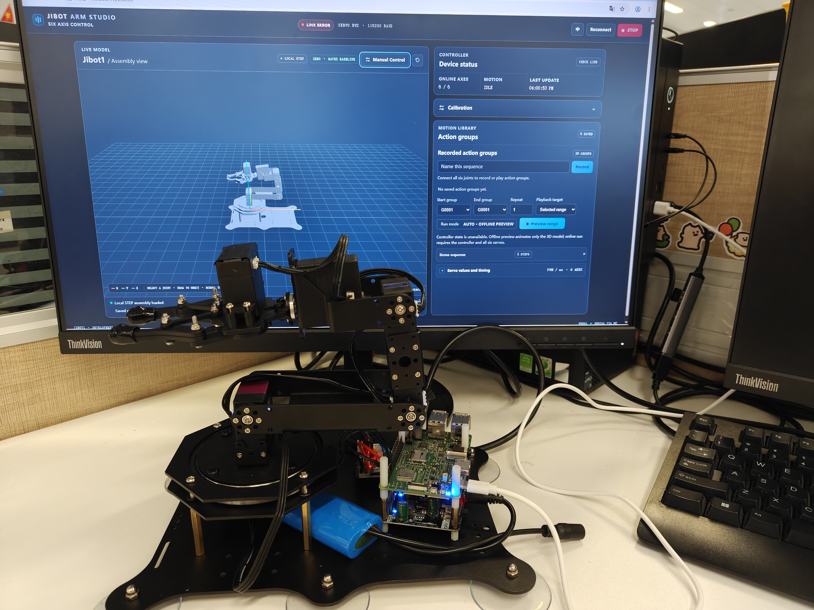

# Jibot1 六轴机械臂控制 Demo
[English](README.md) | [简体中文](README_zh.md)

[](https://github.com/Quectel-Pi/)

本项目使用 Quectel Pi M2 和 ZL-IS2，通过网页控制台操作众灵 Jibot1 六轴总线舵机机械臂。用户可以单独调节各关节、录制并播放动作组，演示预设位置的抓取与放置，并通过网页中的 3D 模型查看机械臂姿态。



**演示视频：** [观看机械臂控制 Demo](assets/demo-robotic-arm-control.mp4)

---

## 功能特性

- 在网页中单独控制 J1–J6 舵机、调节各关节角度并查看在线状态。
- 录制、保存和播放动作组；预置前抓、左抓、右抓和放置动作可用于固定位置抓取演示。
- 加载 Jibot1 STEP 模型，并根据关节状态更新 3D 姿态；支持旋转、缩放和关节选择。
- 支持离线模型预览与 STOP 停止命令；离线预览不会驱动实体机械臂。

---

## 硬件配置

| 硬件 | 要求与用途 |
|---|---|
| Quectel Pi M2 开发板 | 必需；运行控制服务 |
| 众灵 Jibot1 六轴总线舵机机械臂 | 必需；由 ZL-IS2 控制器驱动 |
| ZL-IS2 / ZLink 控制板 | 必需；通过 UART 与 M2 通信 |
| UART 连接线 | 必需；连接 M2 40-pin 与 ZLink 控制板 |
| M2 电源与机械臂电池 | 必需；按设备规格供电，ZLink 控制板由机械臂电池供电 |
| 浏览器客户端 | 必需；需能通过网络访问 M2 网页控制台 |

**舵机 ID 设置**

本 Demo 要求 J1–J6 分别使用唯一 ID 000–005。部分新购机械臂的总线舵机可能全部为默认 ID 000；首次运行前，请按 ZL-IS2/ZLink 随附的官方说明逐个设置舵机 ID。本 Demo 不会自动分配 ID。确认各舵机 ID 唯一且对应正确关节后，再启动程序。

**硬件连接**

以下为 M2 40-pin 接口与 ZLink UART 的连接，针脚编号为物理针脚编号：

| M2 40-pin 针脚 | ZLink 控制板 UART |
|---:|---|
| 9 | GND |
| 8 | RX |
| 10 | TX |

不要将机械臂电池电源接入 M2 的 40-pin 接口。详细接线说明见[接线与上电方案](docs/01-接线与上电方案.md)。

---

## 快速开始

在 Quectel Pi M2 的 Linux 系统中执行以下步骤。项目要求 Python 3.10 或更高版本；可先运行 `python3 --version` 确认。

启动程序前，请先确认舵机 ID 已按“硬件配置”设置为 000–005 且彼此唯一。

```bash
# 1. 安装 Git 和 Python 虚拟环境组件
sudo apt update
sudo apt install -y git python3 python3-venv nano
python3 --version  # 确认版本为 3.10 或更高

# 2. 直接在开发板上从 GitHub 下载项目
mkdir -p ~/projects
cd ~/projects
git clone https://github.com/Quectel-Pi/demo-robotic-arm-control.git
cd demo-robotic-arm-control

# 3. 创建虚拟环境并安装项目依赖
bash scripts/deploy_environment.sh

```

**配置浏览器访问 IP**

在项目目录运行 `nano config.yaml`，将 `web.allowed_client_ip` 设置为浏览器设备的实际局域网 IP。示例中的地址需要替换为浏览器设备的地址，不能填写 M2 的地址，也不要添加 CIDR 后缀：

```yaml
web:
  allowed_client_ip: "192.168.1.23" # 替换为浏览器设备的实际 IP，不要添加 CIDR 后缀
```

在 nano 中按 Ctrl+O、Enter 保存，再按 Ctrl+X 退出。

**启动网页控制台**

```bash
bash scripts/start_web.sh
```

服务默认监听 8080 端口。本机回环地址始终允许访问；网络访问只允许配置的浏览器设备。在 M2 本机浏览器中打开 `http://127.0.0.1:8080/`；从其他设备访问时，在 M2 终端运行 `hostname -I` 查看开发板的网络地址，再从已配置的浏览器设备打开 `http://<M2_IP>:8080/`。如果浏览器设备的 IP 地址变化，更新 `config.yaml` 后重启服务。手动启动时，服务在前台运行，按 Ctrl+C 停止。

**可选：开机自动启动**

如需开发板启动后自动运行网页服务，可运行开机启动管理脚本并选择启用；脚本会安装 systemd 服务，端口 8080 空闲时也会立即启动服务。也可直接指定操作：

```bash
bash scripts/manage_autostart.sh enable  # 启用开机启动
bash scripts/manage_autostart.sh status  # 查看服务状态
bash scripts/manage_autostart.sh disable # 禁用开机启动
```

启用和禁用需要 sudo 权限。若 8080 已有服务在运行，脚本会保留当前进程，只启用下次开机启动。禁用开机启动不会停止当前服务。不开启此选项时，仍可使用 `bash scripts/start_web.sh` 手动启动。

**运行结果**

网页加载 Jibot1 三维装配模型，显示控制器连接状态和六个关节的在线数量。六个舵机全部在线时可使用在线控制；未全部在线时可使用离线预览，预览只播放模型动画。

3D 视图仅在模型、姿态或视角变化时重绘；模型动画最高 30 FPS。鼠标拖动 3D 视图时最高 60 FPS，并临时降低渲染倍率，结束后恢复，以提升拖动响应并减少开发板图形负载。

**使用说明**

- 点击 3D 模型中的关节，或打开手动控制面板，调节单个关节的目标角度；松开滑块后提交运动命令。
- 在动作组区域录制并保存关节姿态，再播放自定义动作组；也可选择前抓、左抓、右抓和放置预置动作演示固定位置的物体抓取与放置。物体需放在对应动作组的预设位置。
- 使用 STOP 按钮停止当前运动。拖动模型可旋转视角，滚动鼠标滚轮可缩放。
- 点击语言按钮可在英文和中文界面之间切换。

**开发者文档**

- [接线与上电方案](docs/01-接线与上电方案.md)：M2 与 ZLink 的 UART 接线及控制器配置。
- [SKILL.md](SKILL.md)：快速上手流程及 AI 助手参考指南。
- 项目自有代码采用 [Apache License 2.0](LICENSE.txt)。第三方组件许可证随组件保留：[Three.js MIT](web/vendor/three-LICENSE.txt) 和 [OCCT STEP 解析组件 LGPL-2.1](web/vendor/occt/LICENSE.md)。Python 依赖见 [requirements.txt](requirements.txt)。

---

## 项目结构

```text
demo-robotic-arm-control/
├── SKILL.md                       # 快速上手流程及 AI 助手指南
├── assets/
│   ├── demo-robotic-arm-control.png # 机械臂与网页控制台现场图
│   └── demo-robotic-arm-control.mp4 # 机械臂控制演示视频
├── docs/
│   └── 01-接线与上电方案.md        # 接线与控制器说明
├── LICENSE.txt                     # 项目 Apache-2.0 许可证
├── config.yaml                      # 串口、安全参数及浏览器 IP 配置
├── pyproject.toml                  # Python 项目元数据
├── requirements.txt                # Python 运行依赖
├── scripts/
│   ├── deploy_environment.sh       # 在开发板创建环境并安装依赖
│   ├── manage_autostart.sh         # 可选安装、启用或禁用 systemd 开机服务
│   └── start_web.sh                # 启动网页控制台
├── src/demo_robotic_arm_control/
│   ├── app/                        # 网页服务、运行环境配置与校准逻辑
│   ├── board/                      # ZL-IS2 串口与舵机接口
│   ├── motion/                     # 轨迹与运动调度
│   └── servo/                      # 机械臂模型与舵机校准
├── web/
│   ├── models/jibot1.step           # Jibot1 STEP 装配模型
│   ├── vendor/                     # Three.js 与 STEP 解析依赖及许可证
│   ├── app.js                      # 网页控制逻辑
│   ├── i18n.js                     # 中英文界面
│   ├── index.html                  # 网页入口
│   └── styles.css                  # 网页样式
├── README.md                       # English README
└── README_zh.md                    # 中文 README
```

---

## 常见问题（FAQ）

### 在 M2 连接的显示器上操作时，3D 视图拖动不流畅怎么办？

STEP 模型由访问网页的设备使用本机 WebGL/GPU 渲染。M2 的集成图形性能通常低于桌面电脑，因此在 M2 本机浏览器中拖动复杂模型可能不如其他电脑流畅；用白名单允许的电脑浏览器访问 M2 时，3D 渲染使用电脑自身的图形性能。可尝试降低显示分辨率或关闭其他占用图形资源的页面。单凭 3D 视图卡顿不能判定舵机或网络故障。

### 显示“离线预览”时，机械臂会实际运动吗？

不会。离线预览只播放网页中的 3D 模型动画，不会向舵机发送运动指令。需要实体机械臂执行动作时，请确认控制器已连接且六个舵机均在线，再使用在线控制或动作组播放。

---

## 报告问题

使用过程中遇到问题，可在[移远官方论坛](https://forumschinese.quectel.com/c/quectel-pi/58)咨询，也欢迎在[GitHub Issues](https://github.com/Quectel-Pi/demo-robotic-arm-control/issues)提交问题，或通过 Pull Request 改进项目。
